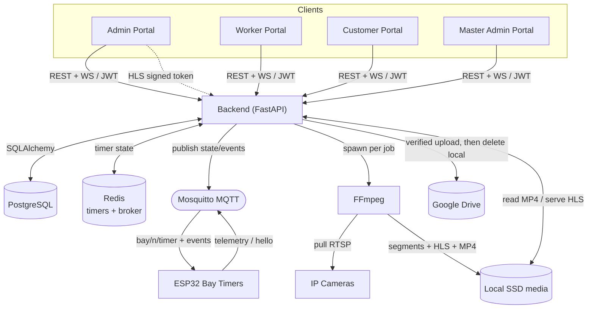

# Baywatch Service OS — System Architecture

A complete map of every module and how they communicate. Built to scale from a
single workshop to 50+ bays across branches.

> **Two invariants the whole design rests on**
> 1. **The backend is the single source of truth** for time, state and authorization. Redis persists timers; the ESP32 and dashboards only *render* backend state.
> 2. **Nothing is ever lost or faked.** Recordings stay on local SSD until a *verified* Drive upload; integrations (Drive, MQTT) are real code that lies *dormant* when their dependency is absent rather than shipping placeholders.

---

## 1. Component inventory

| Component | Tech | Role |
|-----------|------|------|
| **Backend API** | FastAPI (`backend/app`) | The brain. REST + WebSocket, owns all business logic. |
| **PostgreSQL** | Postgres 16 | System of record (jobs, sessions, recordings, users, devices, audit). |
| **Redis** | Redis 7 | Persistent **bay-timer** state + Celery broker. Survives restarts. |
| **MQTT broker** | Mosquitto | Carries timer state/events to the **ESP32** physical timers. |
| **ESP32 Bay Timer** | ESP32 + RGB LED + 7-seg + buzzer | Physical countdown. Display-only; never computes time. |
| **FFmpeg** | host binary | Records each bay's camera (RTSP/test) → HLS live + final MP4. |
| **Camera Registry** | `BayCamera` + `routers/cameras.py` | The physical IP camera bound to each bay (control-plane). |
| **Timer Registry** | `TimerDevice` + `routers/timers.py` | The physical ESP32 bound to each bay (control-plane). |
| **Local SSD media** | `backend/media/` | Recording segments, final MP4, live HLS playlists. |
| **Google Drive** | Drive API v3 (service account) | Long-term recording archive (offloads the SSD). |
| **Frontend** | React + Babel (static) | 4 portals (below), `BW_API` client, polling + WS hooks. |

### Portals (one React app, role-routed by JWT)

| Portal | Audience | Sees |
|--------|----------|------|
| **Admin** | Branch staff | Live Bay Dashboard, Camera + **Timer Connection**, Job Assignment/Queue, Parts Time, Workers, Leave, Reports, Work Completion, **Storage Management**. Drives START/PAUSE/RESUME/COMPLETE. |
| **Worker** | Technicians | Own active job (live ticking timer + job card + recording), queue, history, leave. View-only. |
| **Customer** | Vehicle owners | Own live service (feed + countdown), service history + recordings, notifications. |
| **Master Admin** | Org owner | All branches: Overview, Bay Monitoring (live feeds), Branch + User management, Work Completion, Global Analytics. |

---

## 2. High-level diagram

```
                                 ┌───────────────────────────────────────────────────────┐
                                 │                  FRONTEND (React, static)              │
                                 │   Admin · Worker · Customer · Master Admin portals     │
                                 │   BW_API (JWT) ── REST  +  WebSocket  +  HLS <video>   │
                                 └───────────────┬───────────────────────────┬───────────┘
                          HTTPS REST / WS (JWT)  │                           │  HLS (signed token)
                                                 ▼                           ▼
   ┌─────────┐  SQL    ┌───────────────────────────────────────────────┐  files   ┌──────────────────┐
   │PostgreSQL│◀──────▶│                BACKEND  (FastAPI)               │◀────────▶│  Local SSD media │
   │ (record  │        │                                                 │          │ segments/HLS/MP4 │
   │ of truth)│        │  routers ─▶ services ─▶ utils                   │          └────────┬─────────┘
   └─────────┘         │   • workflow_engine (lifecycle choke-point)     │                   │ verified upload
                       │   • timer (Redis)   • recording_service (FFmpeg)│   spawn   ┌────────▼─────────┐
   ┌─────────┐  state  │   • mqtt_service    • scheduler_service (Drive) │──────────▶│  FFmpeg process  │
   │  Redis  │◀──────▶ │   • streaming_service • camera/drive services   │  per job  │ RTSP→HLS + MP4   │
   │ timers  │         └───┬───────────────┬───────────────┬─────────────┘           └──────────────────┘
   └─────────┘             │ MQTT          │ Drive API v3  │ RTSP pull
                           ▼               ▼               ▼
                   ┌──────────────┐  ┌────────────┐  ┌──────────────┐
                   │  Mosquitto   │  │Google Drive│  │ IP Cameras   │
                   │   broker     │  │  (archive) │  │ (per bay)    │
                   └──────┬───────┘  └────────────┘  └──────────────┘
                          │ bay/<n>/timer (1s) + start/pause/resume/complete
                          ▼
                   ┌──────────────────────────────┐
                   │  ESP32 Bay Timers (per bay)   │
                   │  RGB LED · 7-seg · buzzer     │
                   │  display-only, no local clock │
                   └──────────────────────────────┘
```

---

## 3. Component diagram (Mermaid)



---

## 4. Communication matrix

| From → To | Protocol | What flows |
|-----------|----------|------------|
| Frontend → Backend | HTTPS REST (`/api/v1/*`), JWT bearer | All commands + data reads |
| Frontend ↔ Backend | WebSocket (`/ws/*`, JWT in query) | 1 Hz dashboard/worker/customer snapshots |
| Frontend → Backend | HLS over HTTP (`/hls/secure/...?token=`) | Live camera feed (signed, no raw RTSP) |
| Frontend → Backend | `<video>` stream (`/api/v1/recordings/{id}/stream?token=`) | Recorded playback (Range / 302→Drive) |
| Backend ↔ PostgreSQL | SQLAlchemy / psycopg | Durable state |
| Backend ↔ Redis | redis-py | Timer state (persist on every change), Celery broker |
| Backend → Mosquitto | paho-mqtt publish | `bay/<n>/timer` (retained, 1 Hz) + `start/pause/resume/complete/restart/test/ota` |
| ESP32 → Mosquitto | PubSubClient publish | `bay/<n>/hello`, `bay/<n>/telemetry` |
| Mosquitto → ESP32 | subscribe | timer state + events |
| Backend → FFmpeg | subprocess | one encoder per running job |
| FFmpeg → IP camera | RTSP pull | source video |
| FFmpeg → SSD | file write | `seg_*.ts` → `video.mp4`, `index.m3u8` |
| Backend → Google Drive | Drive API v3 (service acct) | upload (size-verified), share-link, delete |

All MQTT topics key on the **globally-unique bay number**; the full payload spec is
in [`MQTT_CONTRACT.md`](MQTT_CONTRACT.md).

---

## 5. The job lifecycle (end-to-end, every module)

`workflow_engine.emit()` is the single choke-point — one admin action cascades to
session, camera, recording, timer (Redis), **MQTT/ESP32**, queue and notifications.

```
ADMIN clicks START  (POST /api/v1/bay-dashboard/{bay}/start)
   │
   ▼  workflow_engine.emit("JOB_STARTED")
   ├─ ServiceSession.status = running                         → PostgreSQL
   ├─ timer.start(bay, est, session)                          → Redis (persisted)
   ├─ recording_service.start(resolve camera)                 → FFmpeg → SSD (HLS+segments)
   ├─ mqtt_service.publish_event(n,"start") + publish_state   → Mosquitto → ESP32 (1 beep, green)
   └─ notify customer (SMS/Email/In-App)                      → Celery / In-App

   ... every 1s: mqtt_service publishes bay/<n>/timer (backend-computed remaining/colour)
                 WS snapshots push live state to Admin/Worker/Customer/Master portals

PAUSE  → session paused · timer.pause · FFmpeg pause · MQTT pause (display freezes)
RESUME → mirror of START
COMPLETE (POST .../complete)
   ├─ timer.stop → elapsed                                    → removed from Redis
   ├─ FFmpeg stop → concat segments → video.mp4 (+ size)      → SSD; path on RecordingSession
   ├─ RecordingSession: status active, expiry = +14 days      → PostgreSQL
   ├─ mqtt complete + DONE state                              → ESP32 (melody → dOnE)
   ├─ promote next queued job; generate completion PDF
   └─ notify customer "service complete"
```

Recording is later archived by the **scheduler** (next section). Playback is always
through the authorized backend endpoint — raw SSD/RTSP/Drive paths are never exposed.

---

## 6. Recording → storage → archive (the storage tier)

```
FFmpeg ──▶ SSD: media/recordings/<session>/seg_*.ts ──concat──▶ video.mp4
                                                                   │
 scheduler_service.archive_sweep (every 6h, or "Sync Now")         │ if Drive configured
   upload_status: local → pending → uploading                      ▼
        ├─ drive_service.upload() : upload + VERIFY SIZE + share-link
        ├─ on success: store drive_file_id/url, status=uploaded,  → completion-PDF link now live
        │              THEN delete local SSD copy                  (never before a verified upload)
        └─ on failure: status=failed, KEEP local, auto-retry next sweep / manual "Retry Upload"

 retention_sweep (14 days): delete Drive file + local media, mark expired
```

The **Storage Management** admin page (`/api/v1/storage`) surfaces this: Total Local
Storage, Google Drive Status, Pending, Failed, Archived, Expired — with Retry / Sync
Now / Refresh. When Drive credentials are absent the whole tier is dormant and
recordings live safely on SSD.

---

## 7. Real-time & playback paths

- **Live dashboards:** `/ws/bay-dashboard`, `/ws/worker`, `/ws/customer` push a JSON
  snapshot every second (`services/snapshots.py`); a 2–3 s REST poll is the fallback.
  Worker/Customer timers tick client-side anchored to backend state and re-sync each poll.
- **Live camera:** `streaming_service` issues HMAC-signed, session-scoped HLS URLs
  (`/hls/secure/{session}/stream.m3u8?token=`). The feed exists only while RUNNING.
- **Recorded playback:** `/api/v1/recordings/{id}` returns metadata + a short-lived
  signed URL; `/stream` serves the local MP4 with HTTP Range, or 302-redirects to
  Drive once archived; expired → friendly 410.
- **Physical timer:** backend → Mosquitto → ESP32 (display only). See §5 + contract.

---

## 8. Identity & multi-tenant

- **Auth:** JWT (role in the token). `require_admin` / `require_master` guard routes.
  Frontend stores the session in **sessionStorage** (per-tab isolation) and routes the
  portal from the token's role — a worker token structurally cannot render Admin/Master.
- **Branch scoping:** Admins see only their `branch_id`; Master sees all branches.
  Bays, cameras, timers, jobs, recordings are all branch-scoped through their bay/user.

---

## 9. Failure & recovery

| Failure | Behaviour |
|---------|-----------|
| Backend restart | Timers restored from Redis (remaining recalculated from absolute timestamps, no drift); orphan FFmpeg reaped; on MQTT connect every active timer state is re-published → ESP32s resync. |
| Redis down | Timer degrades to in-process memory (logged loudly); non-persistent until Redis returns. |
| ESP32 restart | Gets the retained `bay/<n>/timer` instantly + sends `hello` → backend resync. |
| MQTT / broker down | Backend timer + dashboards unaffected; physical timers dormant; paho auto-reconnects. |
| Camera unreachable | FFmpeg watchdog dev-falls-back to a test source; recording never breaks the job. |
| Drive down / unconfigured | Recordings kept on SSD; uploads marked failed/pending and retried; never lost. |
| Any recording/MQTT error | Wrapped in try/except in `workflow_engine` — never breaks the core job flow. |

---

## 10. Scaling to 10 → 50+ bays

- **Timers:** one Redis key per bay; the 1 Hz MQTT publisher iterates only *active*
  timers. MQTT fan-out is the broker's job — trivial at 50 bays. ESP32s are independent.
- **Recording:** one FFmpeg process per *running* job (not per bay). CPU is the limit;
  scale by branch (one backend + NVR per workshop) and archive aggressively to Drive.
- **Storage:** the SSD only holds *un-archived* recordings; the 6-h sweep + 14-day
  retention keep the footprint bounded regardless of bay count.
- **Backend:** stateless except Redis/PG — horizontally scalable behind a load balancer;
  move the scheduler/MQTT publisher to a single worker (or Celery beat) to avoid duplicate
  publishes when running multiple API replicas.
- **Multi-branch:** already branch-scoped; the Master portal aggregates. Each branch can
  run its own broker + cameras while sharing the central DB, or be fully isolated per site.
