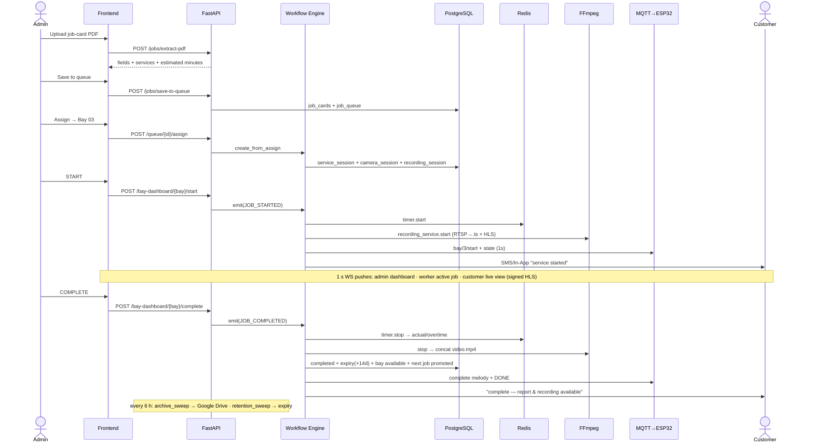

# 03 — Complete Workflow Engine (every workflow, step by step)

> Source of truth: [backend/app/services/workflow_engine.py](../backend/app/services/workflow_engine.py).
> One admin action fires **one event** that cascades to the session, the camera, the
> recording, the bay timer, the queue and customer notifications — all in one DB
> transaction, all audited.
> See also: [01 System Architecture](01_SYSTEM_ARCHITECTURE.md) ·
> [08 API](08_API_DOCUMENTATION.md) · [05 Database](05_DATABASE_DOCUMENTATION.md)

The five events (docstring of workflow_engine.py):

```
JOB_ASSIGNED  -> create session (assigned) + camera (off) + recording (idle)
JOB_STARTED   -> session running, camera on, recording recording, notify
JOB_PAUSED    -> session paused, camera off, recording paused, notify
JOB_RESUMED   -> session running, camera on, recording recording, notify
JOB_COMPLETED -> session completed, recording available (14d signed URL),
                 bay released, next queued job promoted, notify
```

---

## 1. Job Creation (manual)

Frontend: Admin → *Job Assignment & Queue* → New Job → `BW_API.createJob`.

```
Step 1  POST /api/v1/jobs/manual  (routers/jobs.py · require_admin)
Step 2  ids.next_job_card_number() → "JC-1073" (max existing number + 1)
Step 3  _resolve_customer(): link to a customer user by explicit id, else
        match mobile, else email → job_cards.customer_id (nullable)
Step 4  INSERT job_cards (vehicle, customer, service, estimated_minutes…)
Step 5  _queue_job(): INSERT job_queue (worker_id, priority, position = last+1)
Step 6  log_action("JOB_CREATED") → audit_logs
Step 7  response {job_card_id, job_card_number, queue_id}
```

```
User Action (Admin fills form) ↓ Frontend (LiveJobAssignment) ↓ Backend (jobs.py)
↓ Database (job_cards + job_queue + audit_logs) ↓ Frontend Update (queue poll refreshes)
```

## 2. PDF Job Card Extraction

Frontend: *Job Assignment & Queue* → Upload PDF → `BW_API.extractPdf(file)`.

```
Step 1  POST /api/v1/jobs/extract-pdf (multipart file)
Step 2  job_extractor.extract_text() — pdfplumber reads the PDF text layer
Step 3  triumph_parser.extract():
          • validate: ≥5 of 7 required keywords ("job card", "customer name",
            "chassis no", "engine no", "technician name", "repair type",
            "customer voice") + brand check → else returns
            "Invalid Job Card" with score + missing keywords
          • parse_fields: ~20 labelled fields via targeted regexes
            (JC number, dates, model, reg/chassis/engine no, km, customer…)
          • Customer-Voice phrases → SERVICE_MAP (e.g. "engine oil" →
            "Engine Oil Service", 15 min default)
Step 4  _build_analysis(): each service matched against parts_master —
          priority 1 exact product_code · 2 service phrase inside a part name ·
          3 service-map default minutes  → rows + total_estimated_minutes
Step 5  response {valid, score, fields, services, analysis, total_estimated_minutes}
Step 6  Admin reviews/edits → POST /api/v1/jobs/save-to-queue (→ workflow #1)
```

## 3. Parts Matching & Estimated Time Calculation

* Estimated minutes for a part = `unit_value × unit-conversion (min/unit)`
  ([routers/parts.py](../backend/app/routers/parts.py)). Changing the conversion
  (`POST /parts/unit-conversion`, confirmation required) recalculates **every** part
  and records the change in `unit_conversion_settings` + audit log.
* A job's `estimated_minutes` becomes the session's `estimated_duration`
  (`× 60` seconds) at assignment — this is what the countdown runs against.
* Alternative path: `POST /api/v1/parts/estimate-from-job-card` extracts part
  numbers from a PDF/Excel and sums matched `estimated_time`.

## 4. Job Queue (per-worker)

[routers/queue.py](../backend/app/routers/queue.py) — all admin-guarded:

| Action | Endpoint | Effect |
|---|---|---|
| View all queues | `GET /api/v1/queue` | Grouped by worker, with full job-card detail per row. |
| Reorder | `POST /queue/{id}/move` `{direction}` | Swaps `queue_position` with the neighbour. |
| Reassign worker | `POST /queue/{id}/reassign` | Moves to end of the new worker's queue; old queue renumbered 1..N. |
| Preferred bay | `POST /queue/{id}/change-bay` | Sets `job_queue.bay_id` (informational until assign). |
| Remove | `DELETE /queue/{id}` | Deletes + renumbers. |
| **Assign to bay** | `POST /queue/{id}/assign` | → workflow #5. |

## 5. Job Assignment / Worker Assignment / Bay Assignment

```
Step 1  POST /api/v1/queue/{queue_id}/assign {bay_id, force}
Step 2  Guard: bay.status must be "available" unless force=true (409 otherwise)
Step 3  workflow_engine.create_from_assign():
          • ids.next_service_session_id() → "SS-2026-000123"
            (max numeric suffix + 1 — collision-proof across deletions)
          • INSERT service_sessions  (status=assigned,
            estimated_duration = job.estimated_minutes × 60,
            customer_id copied from the job card)
          • INSERT camera_sessions   (id "CAM-{bay}-{seq}", status=off)
          • INSERT recording_sessions (id "REC-2026-000123", status=idle,
            worker_id + customer_id + job_card_id denormalised for ownership checks)
          • job_queue row → status=assigned, bay_id set
          • bay.status → "running" (occupied)
          • log_action("JOB_ASSIGNED")
Step 4  Worker's queue renumbered; response {service_session_id, bay_id}
        — "Assigned to bay; service session created (NOT STARTED)"
```

The bay tile now shows the job in READY state; the timer has **not** started.

## 6. Timer Workflow (START → countdown → overtime)

Engine: [utils/timer.py](../backend/app/utils/timer.py) — Redis-persisted,
timestamp-anchored (see [01 §6](01_SYSTEM_ARCHITECTURE.md#6-timer-architecture)).

```
START   timer.start(bay_id, estimated_seconds, session_id, meta)
        → Redis key bay_timer:{bay_id} {current_status:RUNNING, start_time:now,
          accumulated_pause_duration:0…} + SADD bay_timer:active
TICKING get_state() computes on every read:
          elapsed   = now − start_time − accumulated_pause
          remaining = estimated − elapsed     (negative ⇒ overtime)
          overtime  = max(0, elapsed − estimated)
PAUSE   pause_time=now, status=PAUSED  (elapsed freezes)
RESUME  accumulated_pause += now − pause_time, status=RUNNING
STOP    returns total elapsed, DELETES the Redis key
        (final numbers persist to PostgreSQL on the session row)
RESTART-SAFE  restore_all() on boot re-reads every active key and recomputes —
        no drift, nothing lost. Redis down ⇒ memory fallback (logged ERROR).
```

Colour stages shown everywhere (UI + ESP32): **green** ≥ 60 % remaining ·
**orange** 20–60 % · **red** < 20 % and all of overtime.

## 7. Camera Workflow (per job)

```
ASSIGN   camera_sessions row created (status "off")
START    workflow engine: cam.status="on", started_at=now
         camera_service.resolve_source(bay_id):
             bay_cameras row with rtsp_url → {kind:"rtsp",
             input: rtsp://user:pass@…}   (credentials injected backend-side only)
             no paired camera → {kind:"test"} (dev synthetic source)
PAUSE    cam.status="off"  (feed hidden, segment stopped)
RESUME   cam.status="on"
COMPLETE cam.status="off", stopped_at=now
```

## 8. Recording Workflow (FFmpeg)

Engine: [services/recording_service.py](../backend/app/services/recording_service.py).

```
START    _spawn_segment(0): one FFmpeg process with TWO outputs —
           • media/recordings/{SS}/seg_000.ts   (MPEG-TS, interruption-safe)
           • media/hls/{SS}/index.m3u8 + live_*.ts  (low-latency live HLS)
         RTSP → "-rtsp_transport tcp -i <url> -c:v copy" (no transcode)
         test  → "-re -f lavfi -i testsrc=960x540:rate=15" + libx264 ultrafast
         _guard_rtsp watchdog: RTSP dead within ~2 s → dev fallback to test source
         state.json: {status:"recording", segments:[…], pid}
PAUSE    _terminate(proc) — 'q' on stdin → SIGINT → SIGKILL escalation
RESUME   _spawn_segment(n+1) → seg_001.ts … (fresh HLS playlist)
COMPLETE stop():
           concat seg_*.ts → video.mp4 ("-c copy -movflags +faststart")
           ffprobe duration · file size · delete the HLS dir (live feed ends)
           returns {video_key:"recordings/{SS}/video.mp4", file_size, duration}
         workflow engine writes onto recording_sessions:
           video_path, file_size, recording_end, duration_seconds,
           created_at, expiry_date = now + 14 days, status=active
CRASH    restore() on boot kills orphan FFmpeg pids, marks state "interrupted"
NO FFMPEG  status "unavailable" — metadata still tracked, no media file
```

## 9. Live Streaming (Master monitoring · Customer live view)

```
While recording, FFmpeg writes live HLS  →  media/hls/{SS}/index.m3u8
Master/Customer API responses include:  streaming_service.signed_url(session_id)
    = /hls/secure/{SS}/stream.m3u8?token=<HMAC>&exp=<now+3600>
routers/streaming.py verifies the token, rewrites the playlist so every .ts
segment URL carries the token too, and serves segments with no-store caching.
Rules: feed exists ONLY while status=running · raw RTSP is never exposed ·
paused/completed → 404 "No live stream for this session".
```

## 10. Pause / Resume Workflows

`POST /api/v1/bay-dashboard/{bay_id}/pause` → `emit("JOB_PAUSED")`:

```
session.status=paused · camera off · recording_sessions.status=idle
timer.pause() (freeze) · FFmpeg segment terminated · bay.status="paused"
MQTT bay/{n}/pause + state push (ESP32 freezes display)
Notification "Your service is temporarily paused." (In-App)
audit_logs JOB_PAUSED
```

`/resume` → `emit("JOB_RESUMED")` mirrors START (new segment, timer resumes,
camera on, In-App notice, MQTT resume).

## 11. Completion Workflow

`POST /api/v1/bay-dashboard/{bay_id}/complete {actual_duration?, notes}` →
`emit("JOB_COMPLETED")`:

```
Step 1  elapsed = timer.stop(bay_id)  (Redis key removed)
Step 2  session: status=completed, end_time=now,
        actual_duration = body.actual_duration or elapsed,
        overtime_duration = max(0, actual − estimated)
Step 3  camera off (stopped_at)
Step 4  recording finalised (workflow #8 COMPLETE) + expiry_date = now + 14 d
Step 5  bay.status = "available"  (bay released)
Step 6  _promote_next(): this queue item → completed; the worker's next queued
        job gets queue_position=0 ("up next" flag — admin still assigns the bay)
Step 7  _generate_completion_pdf(session) → Celery task (best-effort)
Step 8  MQTT: bay/{n}/complete (melody) + retained DONE state
Step 9  Notification "Your service is complete. Report & recording are
        available." (SMS + Email + In-App)
Step 10 audit_logs JOB_COMPLETED · commit
```

## 12. PDF Generation (completion report)

Two real paths:

* **Server-side** ([utils/pdf_generator.py](../backend/app/utils/pdf_generator.py),
  triggered via Celery `recording_tasks.generate_completion_pdf`): builds HTML with the
  Service Recording section (availability, REC id, duration, expiry, link) →
  WeasyPrint → upload to MinIO bucket `completion-pdfs` → signed URL. Degrades to a
  no-op when WeasyPrint/MinIO are absent (dev).
* **Client-side** (`wapCompletionPdf` in [live/live.jsx](../frontend/live/live.jsx),
  jsPDF): the PDF the portals actually download today — full job summary + Service
  Recording block + *"This recording will automatically expire after 14 days."*

## 13. Customer Notification Workflow

```
workflow_engine._notify():
Step 1  INSERT notifications (customer_id, session_id, type, message, channels)
        — this is the in-app feed, always written
Step 2  notification_tasks.dispatch() in-process:
          SMS   → MSG91 (real HTTP call; v5 Flow API when MSG91_FLOW_ID set,
                  legacy sendhttp otherwise; numbers normalised to 91XXXXXXXXXX)
          Email → SendGrid hook present but the send call is stubbed (commented)
        Providers unconfigured → safe no-op; a failed SMS never breaks the job.
Events: SERVICE_STARTED (SMS+Email+In-App) · SERVICE_PAUSED (In-App) ·
        SERVICE_RESUMED (In-App) · SERVICE_COMPLETED (SMS+Email+In-App)
```

## 14. Google Drive Upload (archival)

[services/scheduler_service.py](../backend/app/services/scheduler_service.py) `archive_sweep()`
— every 6 h, plus on-demand via Storage Management:

```
Step 1  eligible = completed recordings with video_path set, no drive_file_id,
        not deleted
Step 2  per recording (_upload_one):
          upload_status=uploading, attempts+1
          drive_service.upload(path, "REC-….mp4"):
              resumable upload → verify remote size == local size
              (mismatch ⇒ delete remote, return failure)
              permissions.create(anyone/reader) → webViewLink
          success → drive_file_id + drive_url + video_url + upload_status=uploaded
                    + uploaded_at  → COMMIT FIRST
                    → only then delete media/recordings/{SS}/ from SSD
          failure → upload_status=failed + upload_error; LOCAL FILE KEPT;
                    retried automatically next sweep
Step 3  Drive not configured → rows marked upload_status="local", nothing deleted
Manual  POST /storage/sync-now (background sweep) · POST /storage/retry/{REC}
```

**Never delete before verified upload** is structural: deletion code runs only after
the size-verified upload *and* the DB commit.

## 15. 14-Day Retention / Expiry

`retention_sweep()` (same 6 h loop):

```
Step 1  recordings with expiry_date ≤ now and not yet deleted
Step 2  drive_service.delete(drive_file_id) if archived
Step 3  rm -rf media/recordings/{SS}/ (freed bytes logged)
Step 4  is_deleted=true · status=expired · video_url=null · drive_url=null
After expiry every surface degrades gracefully:
  metadata API → {available:false, message:"This service recording has expired
  and is no longer available."} · stream URL → 410 Gone (same message) ·
  UI badge → EXPIRED · "expiring" badge appears in the last 3 days
  (recordings.status: ≤3 days left ⇒ "expiring").
(A legacy Celery-beat daily task recording_tasks.expire_old_recordings exists for
the old MinIO path; the live path is the scheduler sweep above.)
```

## 16. Live Bay Dashboard (admin real-time)

```
snapshots.dashboard(db): every non-completed session + bay + worker + job +
timer.get_state(bay) → pushed via WS /ws/bay-dashboard every 1 s
(routers/ws.py) and served via GET /api/v1/bay-dashboard (3 s poll fallback).
```

## 17. Worker Performance

`GET /api/v1/reports/worker-performance` ([routers/reports.py](../backend/app/routers/reports.py)):
per completed session — estimated/actual/overtime minutes and
`score = 100 if no overtime else max(70, 100 − overtime_minutes // 3)` + the
recording cell (signed URL). The same score appears in the worker's own history.

## 18. Master Admin Monitoring

`GET /api/v1/master/bay-monitoring` ([routers/master.py](../backend/app/routers/master.py)):
per-branch bay cards with session, worker, timer state, camera/recording status and a
signed live-feed URL **only while RUNNING** (privacy rule). View-only by design.

## 19. Customer Live Monitoring

`GET /api/v1/customer/active-service` + WS `/ws/customer`: the customer's own active
session with remaining seconds and `live_feed_url` (signed HLS) only while running.
Ownership enforced by `customer_id == me.id` in every query.

## 20. ESP32 Physical Timer / 21. MQTT Communication

Each lifecycle event is mirrored to the bay's physical display
(`_publish_timer_mqtt` in workflow_engine.py → [mqtt_service.py](../backend/app/services/mqtt_service.py)):
start/pause/resume → event beep + immediate state push; complete → melody + retained
DONE screen. A 1 s publisher keeps every active countdown synced; `hello` from a
rebooted device triggers an instant resync. Full device documentation:
[09_EXTERNAL_DEVICE_INTEGRATION.md](09_EXTERNAL_DEVICE_INTEGRATION.md) and
[docs/MQTT_CONTRACT.md](../docs/MQTT_CONTRACT.md).

---

## Master sequence — one job, end to end


