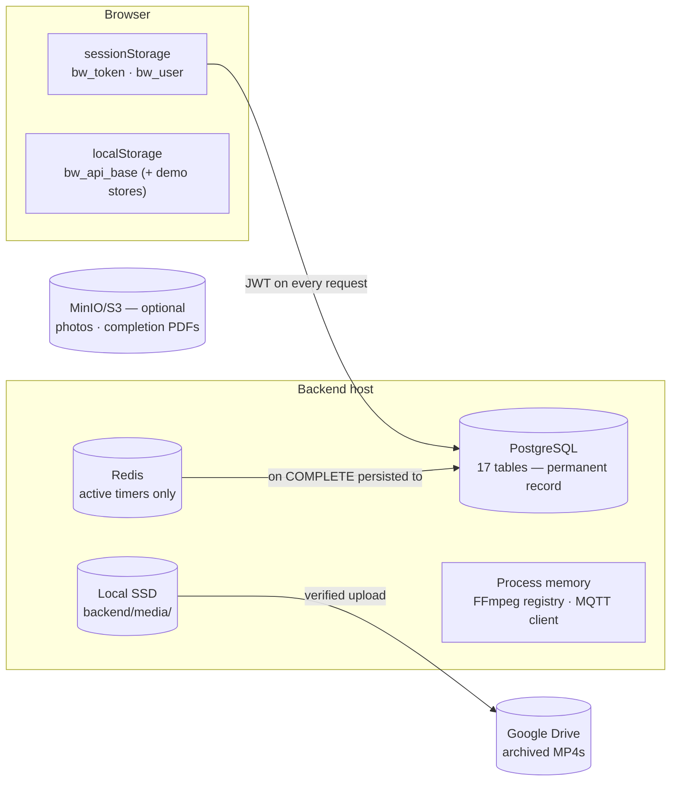

# 04 — Storage & Data Flow Map

> Where every piece of data lives, who writes it, and who deletes it.
> Cross-references: [05 Database](05_DATABASE_DOCUMENTATION.md) ·
> [03 Workflow Engine](03_COMPLETE_WORKFLOW_ENGINE.md)



---

## Hardcoded values (constants that change behaviour)

| File | Name / value | Purpose |
|---|---|---|
| [frontend/serve.py](../frontend/serve.py) | `PORT = 7890` | Frontend dev server port. |
| [frontend/js/api.js](../frontend/js/api.js) | `BASE = localStorage 'bw_api_base' or 'http://localhost:8000'` | Backend URL. |
| [frontend/js/api.js](../frontend/js/api.js) | `TKEY='bw_token'`, `UKEY='bw_user'` | sessionStorage keys. |
| [frontend/js/api.js](../frontend/js/api.js) | poll default `2000 ms`; WS retry backoff `min(1500×n, 8000)`, max 6 attempts | Real-time behaviour. |
| [backend/app/config.py](../backend/app/config.py) | defaults: `recording_retention_days=14`, `jwt_expire_minutes=720` (env overrides to 1440), `mqtt_topic_prefix="bay"`, `cors_origins="http://localhost:7890,http://localhost:3000"` | Settings defaults (overridable in [.env](../backend/.env)). |
| [utils/recordings.py](../backend/app/utils/recordings.py) | `PLAYBACK_TTL = 2*3600` · `EXPIRING_DAYS = 3` | Signed playback URL lifetime; "Expiring Soon" threshold. |
| [services/streaming_service.py](../backend/app/services/streaming_service.py) | `TTL = 3600` | Live HLS signed-URL lifetime. |
| [services/scheduler_service.py](../backend/app/services/scheduler_service.py) | `SWEEP_INTERVAL = 6*3600` | Archive + retention sweep cadence. |
| [services/recording_service.py](../backend/app/services/recording_service.py) | `MEDIA_ROOT = $BW_MEDIA_ROOT or backend/media`; test source `testsrc=960x540:rate=15`; HLS `hls_time 2 / list 5` (rtsp) and `1 / 3` (test) | Recording pipeline. |
| [utils/timer.py](../backend/app/utils/timer.py) | `KEY_PREFIX="bay_timer:"`, `ACTIVE_SET="bay_timer:active"` | Redis keys. |
| [routers/cameras.py](../backend/app/routers/cameras.py) / [routers/timers.py](../backend/app/routers/timers.py) | `ONLINE_WINDOW = 90` s | Device online threshold. |
| [routers/ws.py](../backend/app/routers/ws.py) | `PUSH_INTERVAL = 1.0` s | WS push cadence; auth close codes 4401/4403. |
| [routers/reports.py](../backend/app/routers/reports.py) (and worker.py) | `score = 100` or `max(70, 100 − overtime_min // 3)` | Performance score formula. |
| [routers/platform.py](../backend/app/routers/platform.py) | `MAX_PER_GROUP = 5` | Global-search results per entity group. |
| [utils/storage.py](../backend/app/utils/storage.py) | `BUCKETS = ["job-cards","profile-photos","service-recordings","completion-pdfs"]` | MinIO buckets. |
| [schemas/job.py](../backend/app/schemas/job.py) | `estimated_minutes: int = 45` | Default job estimate. |
| [seed.py](../backend/app/seed.py) | `master/master123`, `admin/admin123`, `worker/worker123`; 4 branches; 8 Chennai bays | Bootstrap credentials/layout. |
| [pages/admin.jsx](../frontend/pages/admin.jsx) `BAYS`, [pages/master.jsx](../frontend/pages/master.jsx) `BRANCH_HEALTH`, [features/completion.jsx](../frontend/features/completion.jsx) `ROSTER/COMPLETIONS` | demo datasets | **Demo mode only** — never shown when logged in. |

---

## PostgreSQL — the permanent record

Per-table create/update/delete map (details & columns in
[05_DATABASE_DOCUMENTATION.md](05_DATABASE_DOCUMENTATION.md)):

| Table | Purpose | Created by | Updated by | Deleted by |
|---|---|---|---|---|
| `branches` | Locations | seed · `POST /master/branches` | — | — |
| `users` | All accounts (4 roles) | seed · `POST /workers` · `POST /master/admins` | `PUT /workers/{id}`, photo upload | `DELETE /workers/{id}` |
| `bays` | Physical work bays | seed · `POST /bays` | `PUT /bays/{id}`, status, workflow engine (running/paused/available) | `DELETE /bays/{id}` (hard only if no history; else archived `is_active=false`) |
| `bay_temp_assignments` | Temporary replacement worker | `POST /bays/{id}/temp-assign` | — | bay delete detaches |
| `bay_cameras` | IP-camera registry (1/bay) | `POST /cameras` (pair) | `PUT /cameras/{id}`, probe/heartbeat stamps `last_seen` | `DELETE /cameras/{id}` (unpair) |
| `timer_devices` | ESP32 registry (1/bay) | `POST /timers` (pair) | `PUT /timers/{id}`, MQTT telemetry stamps `last_seen`/ip/firmware | `DELETE /timers/{id}` |
| `imported_files` | Parts import files (versioned) | `POST /parts/import-rows`, `/import-file` | `/files/{id}/replace` (version+1, history) | `DELETE /parts/files/{id}` |
| `parts_master` | Parts + labour times | imports · `POST /parts` | `PUT /parts/{id}`, unit-conversion recalc | part delete · **CASCADE on file delete** |
| `unit_conversion_settings` | min/unit history | seed · `POST /parts/unit-conversion` | — (append-only) | — |
| `job_cards` | The job (vehicle+customer+service) | `POST /jobs/manual`, `/save-to-queue` | `PUT /jobs/{id}` | — (kept for history) |
| `job_queue` | Per-worker ordered queue | job creation | move/reassign/change-bay/assign · engine marks completed | `DELETE /queue/{id}` |
| `service_sessions` | One bay visit (the work) | `workflow_engine.create_from_assign` | `emit()` on every lifecycle event (status, start/end, actual/overtime) | — (permanent history) |
| `camera_sessions` | Per-job camera on/off | create_from_assign | emit() (on/off, timestamps) | CASCADE with session |
| `recording_sessions` | Video metadata + archival lifecycle | create_from_assign | emit() (status, duration, expiry, video_path, file_size) · scheduler (drive_file_id, drive_url, upload_status, uploaded_at) · retention (expired, is_deleted) | never deleted — flagged `is_deleted` |
| `notifications` | Customer in-app feed | `workflow_engine._notify()` | — | — |
| `audit_logs` | Append-only audit trail | `log_action()` from every router/engine | — | — |
| `leave_requests` | Worker leave | `POST /leave` | approve/reject (status, decided_by/at) | — |

## Redis — active timers only

| Key | Content | Written | Removed |
|---|---|---|---|
| `bay_timer:{bay_id}` | JSON: status, session/job/worker ids, estimated_duration, start_time, pause_time, accumulated_pause_duration | `timer.start/pause/resume` (every state change) | `timer.stop` on COMPLETE |
| `bay_timer:active` | SET of bay_ids with live timers | SADD on start | SREM on stop (stale entries pruned on boot) |

Completed timers are **never** kept in Redis — final numbers go to
`service_sessions.actual_duration / overtime_duration`. Redis down ⇒ documented
in-memory fallback (timers lost on restart, logged ERROR).

## Local SSD — `backend/media/`

| Path | Content | Created | Deleted |
|---|---|---|---|
| `recordings/{SS}/seg_NNN.ts` | Per-interval MPEG-TS capture | FFmpeg on START/RESUME | after concat (folder removal on archive/retention) |
| `recordings/{SS}/video.mp4` | Final concatenated video | `recording_service.stop()` | **only after verified Drive upload** (archive_sweep) or at 14-day retention |
| `recordings/{SS}/state.json` | Pipeline state (status, segments, pid) | every transition | with the folder |
| `recordings/{SS}/metadata.json` · `ffmpeg.log` | Job context · FFmpeg output | START | with the folder |
| `hls/{SS}/index.m3u8 + live_*.ts` | Live stream (rolling window) | while recording | on COMPLETE (`stop()` rmtree) |

## Browser — localStorage

| Key | What | Why |
|---|---|---|
| `bw_api_base` | Backend base URL override | Shared config is safe cross-tab; non-sensitive. |
| legacy `bw_token`/`bw_user` | **removed on load** | One-time hygiene in api.js so old shared-token auth can never leak back. |
| demo stores (`features/partsstore.jsx`, queue/timer demo state) | Demo-mode data | Only used when not logged in. |

## Browser — sessionStorage (per tab)

| Key | What | Why |
|---|---|---|
| `bw_token` | JWT | **Per-tab isolation**: three tabs = three independent role sessions; refresh keeps each tab's own login. The role is decoded from this token (`roleOf()`), making portals un-spoofable. Cleared on logout and on any 401. |
| `bw_user` | `{id, name, role, branch_id}` | Display only — never trusted for authorization. |

## Runtime memory (lost on restart, by design)

| Holder | State | Recovery |
|---|---|---|
| `recording_service._active` | session → FFmpeg `Popen` + segment index + source | `restore()` kills orphans via persisted `state.json` pid, marks `interrupted`. |
| `mqtt_service` | paho client, `_connected`, `_bay_map` cache | reconnect loop; on connect re-publishes every active timer. |
| `timer._mem` | fallback timers when Redis is down | none (that's why Redis is required for production). |
| WS connections ([routers/ws.py](../backend/app/routers/ws.py)) | one asyncio loop per socket, 1 s push | client auto-reconnects with backoff. |
| `drive_service._service` | cached Drive client | rebuilt lazily. |
| scheduler/MQTT daemon threads | `bw-scheduler`, `bw-mqtt-state` | restarted in lifespan. |

## Google Drive

| What | Detail |
|---|---|
| Uploaded | `recordings/{SS}/video.mp4` as `"{REC-id}.mp4"` into folder `GOOGLE_DRIVE_FOLDER_ID`. |
| Who uploads | `scheduler_service.archive_sweep()` (6 h loop) and manual Sync Now / Retry from Storage Management. |
| Verification | remote size must equal local size, else remote deleted + retry; share permission `anyone:reader`. |
| Where the link is stored | `recording_sessions.drive_file_id`, `drive_url`, `video_url`, `uploaded_at`, `upload_status='uploaded'`. The playback endpoint then 302-redirects to Drive. |
| Deletion | `retention_sweep()` calls `drive_service.delete(file_id)` at expiry. |

## MinIO / S3 (optional, dormant without a server)

Buckets `profile-photos` (worker photo upload), `completion-pdfs` (server-side
WeasyPrint report), `job-cards`, `service-recordings` (legacy path). All helpers in
[utils/storage.py](../backend/app/utils/storage.py) no-op gracefully when MinIO is absent.

## Camera SD card — honest status

There is **no SD-card code in this repository**. The implemented design records the
camera's **RTSP stream** on the backend host (FFmpeg → local SSD → Google Drive), so
the camera's own SD card is at most an independent NVR-side fallback, outside this
system. The only device-side hook is `POST /api/v1/cameras/heartbeat`
(field-agent/NVR liveness ping).

---

## One recording's life (storage view)

```
START          media/recordings/SS-…/seg_000.ts grows  ·  media/hls/SS-…/ live
COMPLETE       seg_*.ts → video.mp4 · HLS dir deleted
               recording_sessions: video_path, file_size, expiry=+14d, status=active
≤ 6 h later    archive_sweep: → Google Drive (verified) → drive_url stored
               → local folder deleted          upload_status=uploaded
day 11–14      status reads "expiring" (≤3 days left)
day 14+        retention_sweep: Drive file deleted · status=expired · is_deleted
forever        the DB row remains (history) — links answer with the friendly
               "recording has expired" message, never a broken page
```
