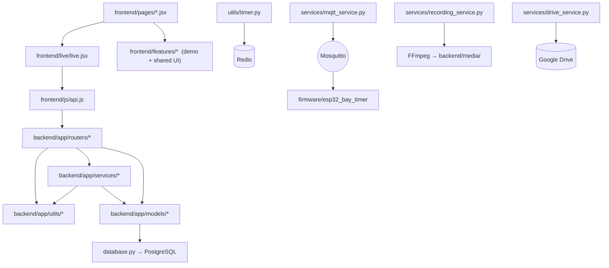

# 07 — Folder Structure (actual project tree)

> Generated from the real repository layout. Every file listed exists.
> Dependency rule of thumb: `frontend → backend routers → services → models/utils → DB`.

```
bsms/
├── ARCHITECTURE.md                  # earlier high-level notes
├── README.md
├── docs/
│   ├── MQTT_CONTRACT.md             # authoritative backend↔ESP32 wire contract
│   ├── SYSTEM_ARCHITECTURE.md       # earlier architecture notes
│   └── ux-audit/                    # AUDIT.md · FINAL_AUDIT.md (UX review)
├── workflow-details/                # ← THIS documentation set (01–11)
│
├── backend/
│   ├── .env                         # active local config (Postgres/Redis/JWT/MQTT/CORS)
│   ├── run.py                       # python3 run.py → uvicorn :8000 (reload)
│   ├── requirements.txt             # backend dependencies (see 06)
│   ├── docker-compose.yml           # fastapi+postgres+redis+minio+celery stack
│   ├── setup_postgres.sh            # idempotent Homebrew Postgres 16 bootstrap
│   ├── Dockerfile
│   ├── alembic.ini · alembic/env.py # migration scaffolding (prod path)
│   ├── media/                       # ⚠ runtime data, not code:
│   │   ├── recordings/{SS-…}/       #   seg_*.ts · video.mp4 · state/metadata/ffmpeg.log
│   │   └── hls/{SS-…}/              #   live index.m3u8 + live_*.ts (deleted on COMPLETE)
│   └── app/
│       ├── main.py                  # FastAPI app: lifespan, middleware, all routers
│       ├── config.py                # pydantic-settings (env-driven)
│       ├── database.py              # engine + SessionLocal + Base + init_db
│       ├── seed.py                  # minimal bootstrap (branches/users/bays)
│       ├── models/                  # SQLAlchemy ORM — 17 tables (see 05)
│       │   ├── base.py              #   TimestampMixin · utcnow
│       │   ├── ids_default.py       #   uuid_pk()
│       │   ├── branch.py · user.py · bay.py · camera_device.py · timer_device.py
│       │   ├── part.py · job.py · session.py · audit.py · leave.py
│       │   └── __init__.py          #   imports all so metadata is complete
│       ├── schemas/                 # Pydantic request/response models
│       │   ├── common.py            #   {success,data,message} envelope · ok()/fail()
│       │   ├── auth.py · user.py · job.py · part.py
│       ├── routers/                 # HTTP/WS surface (one file ≈ one feature area)
│       │   ├── auth.py              #   login/logout/me
│       │   ├── bays.py              #   bay CRUD + safe delete + temp assign
│       │   ├── cameras.py           #   camera registry + probes + heartbeat
│       │   ├── timers.py            #   ESP32 registry + MQTT commands
│       │   ├── parts.py             #   parts/files/unit-conversion/audit/estimate
│       │   ├── jobs.py              #   manual create · PDF extract · save-to-queue
│       │   ├── queue.py             #   queue ops + ASSIGN (creates the session)
│       │   ├── bay_dashboard.py     #   dashboard GET + start/pause/resume/complete
│       │   ├── worker.py            #   worker's own active/queue/history
│       │   ├── customer.py          #   customer's own service/history/notifications
│       │   ├── leave.py             #   apply/approve/reject
│       │   ├── reports.py           #   worker-performance · work-completion · summary
│       │   ├── recordings.py        #   authorized playback + Range stream (+schema)
│       │   ├── storage_admin.py     #   storage overview · sync-now · retry
│       │   ├── platform.py          #   global search · activity · job timeline
│       │   ├── master.py            #   branches/admins/monitoring/analytics
│       │   ├── ws.py                #   /ws/bay-dashboard · /ws/worker · /ws/customer
│       │   └── streaming.py         #   /hls/secure/{SS}/… signed live HLS
│       ├── services/                # engines (business logic)
│       │   ├── workflow_engine.py   #   THE job lifecycle (assign/start/pause/resume/complete)
│       │   ├── recording_service.py #   FFmpeg segments + HLS + concat + restore
│       │   ├── camera_service.py    #   bay → RTSP source resolution
│       │   ├── streaming_service.py #   HMAC-signed live HLS URLs
│       │   ├── scheduler_service.py #   6h archive+retention sweeps · storage overview
│       │   ├── drive_service.py     #   real Google Drive v3 (service account)
│       │   ├── mqtt_service.py      #   1s state publisher + events + telemetry intake
│       │   └── snapshots.py         #   shared REST/WS read-models
│       ├── tasks/                   # optional Celery layer
│       │   ├── celery_app.py        #   app + daily beat (legacy expiry)
│       │   ├── notification_tasks.py#   MSG91 SMS (real) · SendGrid (stub) · dispatch()
│       │   └── recording_tasks.py   #   completion-PDF task · legacy capture/expiry
│       └── utils/
│           ├── auth.py              #   JWT + require_* role guards
│           ├── security.py          #   pbkdf2_sha256 hash/verify
│           ├── timer.py             #   Redis persistent bay timer engine
│           ├── recordings.py        #   status/expiry maths + HMAC playback tokens
│           ├── ids.py               #   JC-/SS-/REC- human ID generators (max+1)
│           ├── audit.py             #   log_action()
│           ├── storage.py           #   MinIO/S3 wrapper (optional)
│           ├── job_extractor.py     #   pdfplumber text + generic field regexes
│           ├── triumph_parser.py    #   Triumph/Bajaj template parser + SERVICE_MAP
│           ├── file_parser.py       #   parts Excel/PDF parsing
│           ├── pdf_generator.py     #   WeasyPrint completion report (optional)
│           └── camera.py            #   legacy env-RTSP capture helpers (superseded
│                                    #   by camera_service + recording_service)
│
├── frontend/
│   ├── index.html                   # loads React/Babel/CDN libs + every JSX in order
│   ├── serve.py                     # static no-cache dev server :7890
│   ├── app.jsx                      # <App/>: landing→role→login→portal, role guard
│   ├── js/
│   │   ├── api.js                   # window.BW_API + useBWPoll + useBWSocket
│   │   │                            # sessionStorage auth (bw_token/bw_user)
│   │   └── parts_data.js            # demo parts dataset
│   ├── components/
│   │   ├── icons.jsx                # SVG icon set (window.Icon)
│   │   └── primitives.jsx           # Avatar/Chip/etc shared primitives
│   ├── pages/                       # portal shells + demo pages
│   │   ├── screens.jsx              #   Landing · RoleSelect · Login
│   │   ├── admin.jsx                #   ADMIN_NAV shell + demo BayDashboard
│   │   ├── master.jsx               #   MASTER_NAV shell + demo pages
│   │   ├── worker.jsx               #   worker tablet shell + demo pages
│   │   └── customer.jsx             #   customer shell + demo pages
│   ├── features/                    # shared + demo feature modules
│   │   ├── workflow.jsx             #   demo WorkflowEngine · ServiceLiveFeed
│   │   ├── baytimer.jsx             #   demo BayTimer store
│   │   ├── queue.jsx                #   demo QueueStore · ConfirmDialog
│   │   ├── completion.jsx           #   WorkCompletion + SHARED recording UI:
│   │   │                            #   RecordingPreviewModal · VideoActions ·
│   │   │                            #   RecordingStatusBadge · RecordingUtil
│   │   ├── jobintake.jsx            #   demo PDF intake (pdf.js/tesseract)
│   │   ├── partstime.jsx · partsstore.jsx · profiles.jsx · baymgmt.jsx
│   ├── live/
│   │   └── live.jsx                 # ALL Live* backend-connected components
│   │                                # (one component per portal tab — see 02)
│   └── css/
│       ├── styles.css · admin.css · responsive.css
│
└── firmware/
    └── esp32_bay_timer/             # PlatformIO project (see 09)
        ├── README.md                #   wiring · flashing · MQTT behaviour
        └── platformio.ini           #   esp32dev · PubSubClient/ArduinoJson/
                                     #   NeoPixel/TM1637
```

## What depends on what



Load-order dependency in the frontend is the **script order in index.html** —
e.g. `live/live.jsx` may use `window.RecordingPreviewModal` because
`features/completion.jsx` loads before it. When adding a file, insert its
`<script>` tag after everything it references.

Key cross-file contracts to know before editing:

* `schemas/common.ok()` envelope ↔ `api.js unwrap()` — change one, change both.
* `utils/ids.py` formats (`SS-…`, `REC-…`) ↔ MQTT topics ↔ media folder names.
* `recording_service.stop()` return keys ↔ `workflow_engine._stop_recording_capture`.
* `recordings.signed_url()` (relative URL) ↔ `recAbsUrl()` in live.jsx (makes it absolute).
* `snapshots.py` shapes ↔ both REST GET and WS push consumers.
