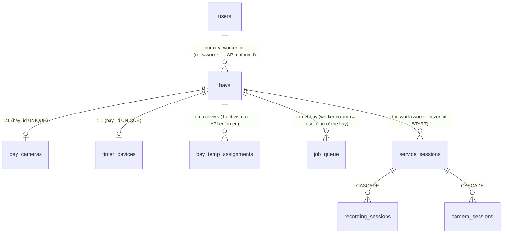

# DATABASE_MAPPING — Bay-First Data Model

> Delta on [05_DATABASE_DOCUMENTATION.md](05_DATABASE_DOCUMENTATION.md): how the
> existing 17 tables implement bay-first **with zero schema changes**, and the
> integrity rules now enforced at the API layer.

## The ownership tables

## Column-level mapping of the model

| Architecture concept | Column(s) | Integrity rule (where enforced) |
|---|---|---|
| Bay owns Worker | `bays.primary_worker_id → users.id` | must be role=worker (`_require_worker_role`, routers/bays.py) |
| Temporary cover | `bay_temp_assignments(bay_id, replacement_worker_id, start_date, end_date, reason)` | dates ordered · worker-role · ≠ primary · **no overlap per bay** (API 409) · deleted by Revert Now |
| Bay owns Camera | `bay_cameras.bay_id` **UNIQUE** | DB constraint |
| Bay owns Timer/ESP32 | `timer_devices.bay_id` **UNIQUE** | DB constraint |
| MQTT topic identity | `bays.bay_number` | **globally unique** across branches (API create/duplicate 409) — topics `bay/{n}/*` derive from it, never stored |
| Job targets a bay | `job_queue.bay_id` (required at intake/change-bay) | API 400 on null |
| Queue grouping | `job_queue.worker_id` | **projection of the bay's worker** — written only by resolution (intake, change-bay, assign, START); never client-supplied |
| Work history | `service_sessions.worker_id`, `recording_sessions.worker_id` | snapshot frozen at JOB_STARTED; immutable afterwards |
| Bay lifecycle | `bays.status`, `bays.is_active` | engine + admin endpoints only; delete archives when history exists |

## Who writes worker columns (complete list)

| Writer | Column | When |
|---|---|---|
| `PUT /bays/{id}` / `POST /bays` | `bays.primary_worker_id` | staffing a bay (Bay Management only) |
| `POST /bays/{id}/temp-assign` | `bay_temp_assignments.*` | replacement |
| `POST /bays/{id}/revert-worker` | deletes cover rows | early restore |
| `jobs.py` intake | `job_queue.worker_id` | = `resolve_bay_worker(bay)` |
| `queue.py change_bay` | `job_queue.worker_id` | re-resolution on bay move |
| `create_from_assign` | `service_sessions.worker_id`, `recording_sessions.worker_id`, `job_queue.worker_id` | assign-time resolution |
| `emit(JOB_STARTED)` | same three | final re-resolution, then frozen |

**Nothing else** writes a worker reference — that is the whole point. A grep for
`worker_id =` in routers/services returns exactly the writers above.

## Things deliberately NOT added

| Considered | Rejected because |
|---|---|
| `worker_bay_mapping` table | `bays.primary_worker_id` *is* the mapping (1 worker per bay; a worker may own several bays — direction matters: bay→worker). |
| DB unique index on `bays.bay_number` | needs an Alembic migration on live data (archived bays may share numbers); runtime guard + documented for the production migration backlog. |
| FK from `job_queue.worker_id` removal | column kept as projection for grouping/history; making it nullable/derived-only would break the worker portal's queue query for zero benefit. |
