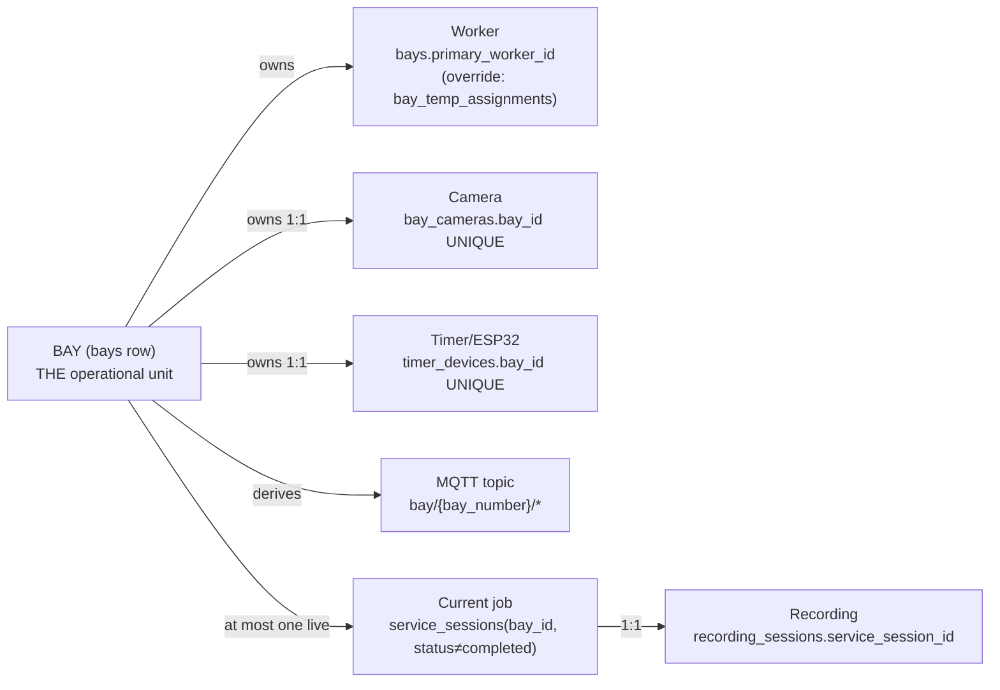

# STATE_FLOW — Single Source of Truth (Phase 2)

> Verified against the implementation on 12 Jun 2026 (suite: `.verify/bw_verify.py`, 37/37).
> Rule: **every fact lives in exactly one place**; everything else is either a
> *resolution* (computed on read) or a *snapshot* (immutable history). There is no
> third category — that's what makes duplicate state impossible.

## The ownership chain

## Where each fact lives (and what is allowed to copy it)

| Fact | Single source | Resolved (computed on read) | Snapshot (immutable copy) |
|---|---|---|---|
| Who works a bay | `bays.primary_worker_id` + active `bay_temp_assignments` row | `resolve_bay_worker()` — every intake/assign/start | `service_sessions.worker_id`, `recording_sessions.worker_id` — frozen **at START** (history: who actually did the job) |
| Which camera films a bay | `bay_cameras` (1:1 unique) | `camera_service.resolve_source()` at START/RESUME | `media/recordings/{SS}/metadata.json` (camera_id at capture time) |
| Which physical timer shows a bay | `timer_devices` (1:1 unique) | drawer/Fleet status; MQTT publisher | — |
| MQTT topic | **derived** from `bays.bay_number` (never stored) | `mqtt_service._state_topic()` / `timers` router | — |
| Countdown time | Redis `bay_timer:{bay_id}` (timestamp-anchored) | `timer.get_state()` on every read; ESP32 only renders | final `actual/overtime_duration` on session at COMPLETE |
| Current job of a bay | `service_sessions` where `bay_id` + status ≠ completed | Fleet View / dashboard / drawer | — |
| Recording lifecycle | `recording_sessions` (status, expiry, drive ids) | playback status computed from `expiry_date` | — |
| Queue ownership | **resolution of the bay** — `job_queue.worker_id` is *maintained equal to* the bay's worker (intake, change-bay, START all re-sync it) | grouping in `GET /queue` | — |

## Why `worker_id` on sessions is NOT duplicate state

`service_sessions.worker_id` looks like a copy of the bay's worker — it is not. It is
a **snapshot taken at the moment work starts** (re-resolved at `JOB_STARTED`,
[workflow_engine.py](../backend/app/services/workflow_engine.py)). If Bay 03's primary
changes next month, last month's completed sessions must still report who actually
did the work. Mutable truth = bay; immutable history = session. The same applies to
`recording_sessions.worker_id` (it also feeds the playback ownership check without joins).

## Re-synchronisation points (where resolution happens)

1. **Job intake** (`POST /jobs/manual|save-to-queue`) — queue row gets the bay's worker.
2. **Change bay** (`POST /queue/{id}/change-bay`) — job moves to the new bay's worker.
3. **Assign** (`create_from_assign`) — session created with the bay's *current* worker.
4. **START** (`emit(JOB_STARTED)`) — final re-resolution; session + recording + queue
   row updated if a temp cover appeared between assign and start. After START the
   worker is frozen (work has begun).

## Duplicate-state audit result

| Suspect | Verdict |
|---|---|
| `job_queue.worker_id` vs bay worker | Not duplicate — *maintained projection*, re-synced at all 4 points above; needed for per-worker queue grouping. |
| `job_queue.bay_id` vs session `bay_id` | Queue = intent (target bay); session = fact (assigned bay). Different lifecycles. |
| `camera_sessions.status` vs recording state.json | DB row = audit of on/off; state.json = process bookkeeping (pid/segments). Different concerns, never read interchangeably. |
| `bays.status` vs timer status | Bay status is the workflow state (available/running/…); Redis holds only time maths. Engine writes both in one event. |
| MQTT topic strings | Derived everywhere from `bay_number`; guarded by **global** bay-number uniqueness (`routers/bays.py create/duplicate`). |
