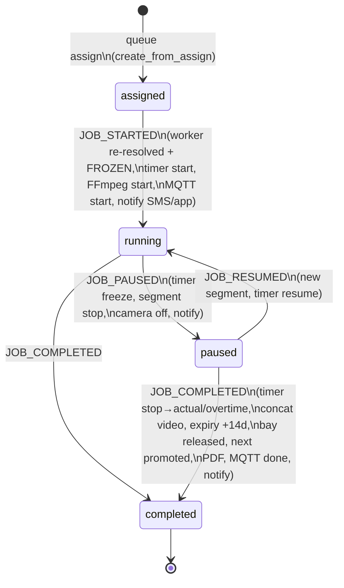

# STATE_MACHINE — Every Status in the System

> All transitions are driven by `workflow_engine.emit()` (sessions) or computed on
> read (bays in Fleet View, devices, recordings). No UI ever writes a status directly.

## ServiceSession (the job) — writes: workflow engine only



## Bay — `bays.status` (engine + admin) and the computed Fleet status

Stored: `available ⇄ running ⇄ paused` (engine) · `maintenance / disabled / deleted`
(admin actions, blocked while a session is active) · archived via `is_active=false`.

Computed per-row in `GET /bays/operations` (`_bay_op_status`):

```
disabled (inactive/disabled) > maintenance > no_worker (UNSTAFFED — red, not
operational) > running / paused (live session) > available
attention flag = no_worker | maintenance | disabled | camera offline |
                 timer offline | temp cover active   → auto-sorted to top
```

## Timer (Redis `bay_timer:{bay_id}`)

```
(absent) READY ──start──> RUNNING ──pause──> PAUSED ──resume──> RUNNING
RUNNING/PAUSED ──stop (COMPLETE)──> key DELETED (final numbers → PostgreSQL)
remaining < 0 ⇒ OVERTIME (state stays RUNNING; colour red)
restart-safe: timestamp-anchored; restore_all() recomputes on boot
```

## RecordingSession

```
idle (created at assign) → recording (START) ⇄ idle (PAUSE/RESUME mirrors)
→ active (COMPLETE: video.mp4 + expiry_date)
→ expiring (computed: ≤3 days left) → expired (retention sweep; is_deleted,
  Drive + local deleted; links answer with a friendly message forever)
upload_status: local → pending → uploading → uploaded | failed(kept+retried)
```

## Temp worker cover (bay_temp_assignments)

```
none ──temp-assign (validated: dates, worker-role, ≠primary, no overlap)──> ACTIVE
ACTIVE ──end_date passes──> auto-restored (resolution stops matching)
ACTIVE ──Revert Now──> row deleted (audited)            [one cover per bay]
```

## Devices

```
Camera:  unpaired → online (last_seen ≤90 s) ⇄ offline · disabled (enabled=false)
ESP32:   unpaired → offline (paired, no telemetry/MQTT) → synced (telemetry ≤90 s
         AND broker connected)
```

## Queue item (job_queue.status)

```
queued (intake; worker = bay's worker, kept in sync by change-bay/START)
→ assigned (bay assign) → completed (engine, at JOB_COMPLETED; next queued item
flagged queue_position=0 = "up next")
```
