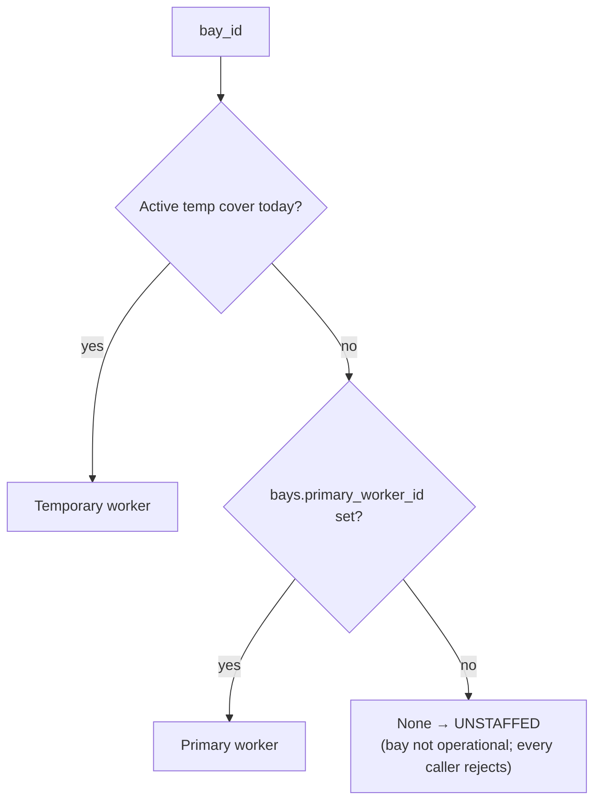

# WORKER_RESOLUTION — The One Resolution Function

> Source: `resolve_bay_worker()` in
> [backend/app/services/workflow_engine.py](../backend/app/services/workflow_engine.py).
> Every worker decision in the product flows through this function.

## The algorithm

```python
def resolve_bay_worker(db, bay_id) -> str | None:
    today = date.today()
    temp = bay_temp_assignments WHERE bay_id AND start_date <= today <= end_date
    if temp:  return temp.replacement_worker_id      # 1. TEMP COVER wins
    return bay.primary_worker_id                     # 2. PRIMARY
                                                     # 3. None = UNSTAFFED
```



## Call sites (all of them)

| # | Caller | Moment | On `None` |
|---|---|---|---|
| 1 | `routers/jobs.py::_resolve_worker_for_job` | Job intake (manual + PDF) | `400 Bay is not operational. Assign a primary worker first.` |
| 2 | `routers/queue.py::change_bay` | Job moved to another bay | same 400 |
| 3 | `routers/queue.py::assign_item` | Guard before going live (even with `force`) | same 400 |
| 4 | `workflow_engine.create_from_assign` | Session creation (defensive re-resolve; router #3 already guarded) | falls back to the queue row's worker — unreachable in practice, keeps FK integrity |
| 5 | `workflow_engine.emit(JOB_STARTED)` | **Final** re-resolution the moment work begins | keeps the assign-time worker |
| 6 | `routers/bays.py` operations/detail/current-worker | Display (Fleet View, drawer, pickers) | renders 🔴 NO WORKER / 🔒 disabled options |

## The freeze point

Resolution is *live* until **START**, frozen after:

```
intake ──resolve──> queue row
change-bay ──re-resolve──> queue row moves
assign ──re-resolve──> session.worker_id (+recording, queue row)
START  ──re-resolve──> session/recording/queue updated ─── FROZEN
        (a temp cover added after START does NOT move a running job —
         the person mid-repair doesn't change because a date rolled over)
```

Verified scenario (suite "full lifecycle"): job assigned under primary →
temp cover added → START → live dashboard, session, recording and completion log
all show the **temp** worker; after revert the bay resolves the primary again while
the completed session permanently keeps the temp worker (correct history).

## Validation around the inputs

- `bays.primary_worker_id` and `bay_temp_assignments.replacement_worker_id` are
  **role-checked** (`_require_worker_role` in routers/bays.py): only `worker` users.
- Temp covers: `end_date ≥ start_date`, replacement ≠ primary, no overlapping cover
  per bay (409), all audited; early termination via `POST /bays/{id}/revert-worker`.
- Auto-restore needs **no job**: the date-range simply stops matching at midnight
  after `end_date`.
